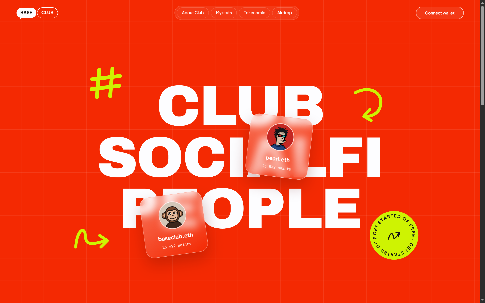
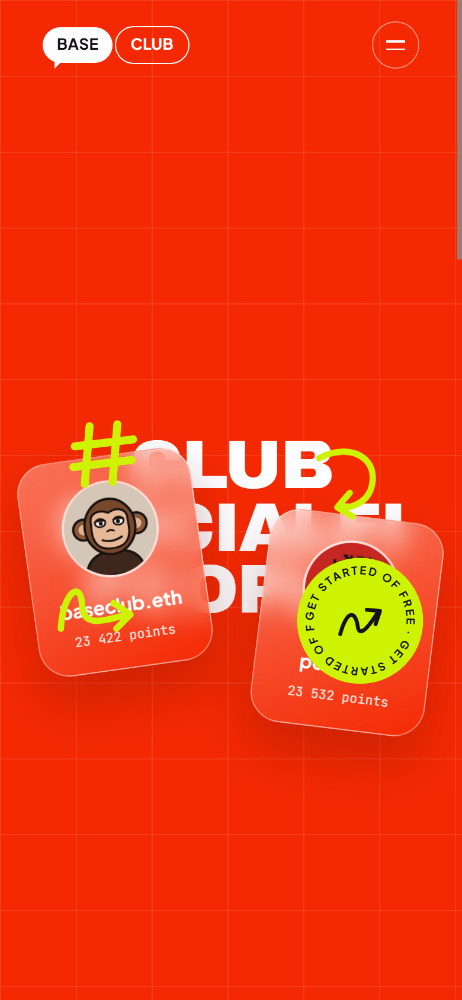
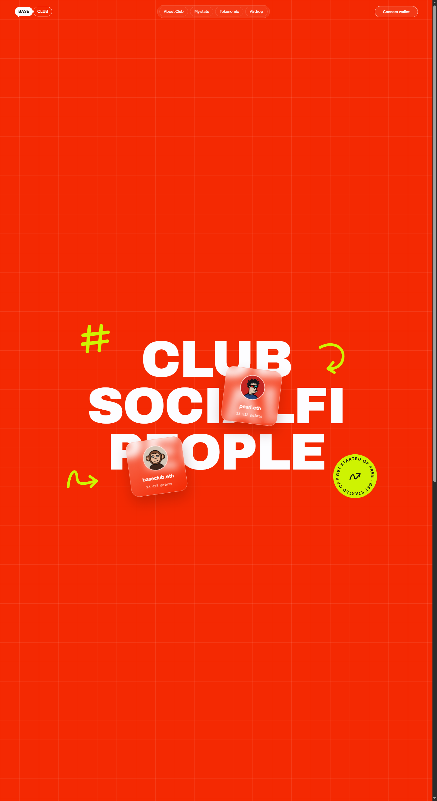

# BASE CLUB — Web3 SocialFi Collective

Standalone web recreation built from the BASE CLUB ("Club SocialFi People") reference design.

## Screenshots

### Desktop Hero (1440×900)


### Mobile Hero (390×844)


### Full Page


## Design System

| Role | Color | Hex |
| :--- | :--- | :--- |
| Quiet 1 (Canvas) | Red Orange | `#F42902` |
| Quiet 2 (Display & Surface) | Snowy White | `#FDFDFF` |
| Loud Accent | Yellow Punk | `#CEF302` |
| Contrast Ink | Void Black | `#140B09` |

- **Typography:** Archivo Black (stacked display headline), Plus Jakarta Sans (UI and body), JetBrains Mono (ranks and point totals).
- **Layout:** Full-bleed red-orange grid hero with stacked `CLUB SOCIALFI PEOPLE` type, yellow-punk hand-drawn ink counterpoint marks, tilted frosted PFP member cards (`pearl.eth`, `baseclub.eth`), rotating circular stamp badge, plus leaderboard, tokenomics, and wallet-connect preview.

## Run Locally

Open `index.html` in any browser or serve statically:

```bash
npx serve .
```
