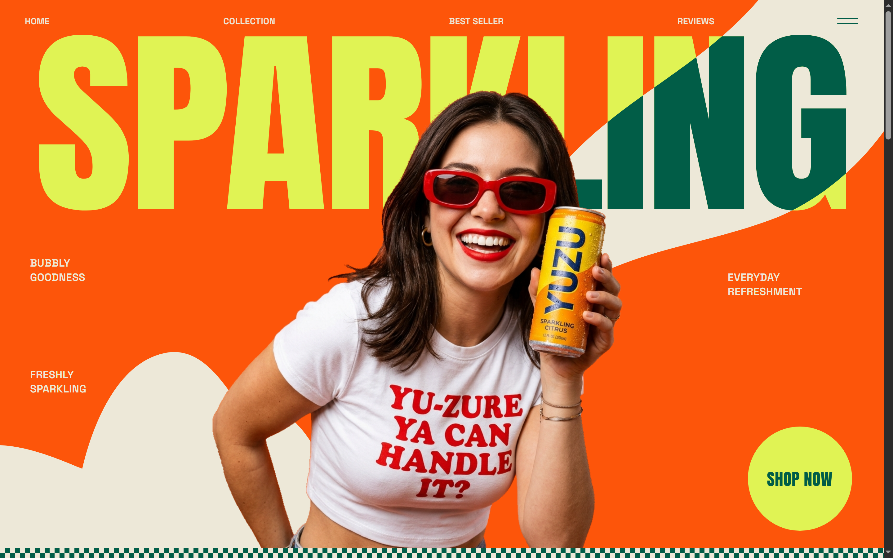
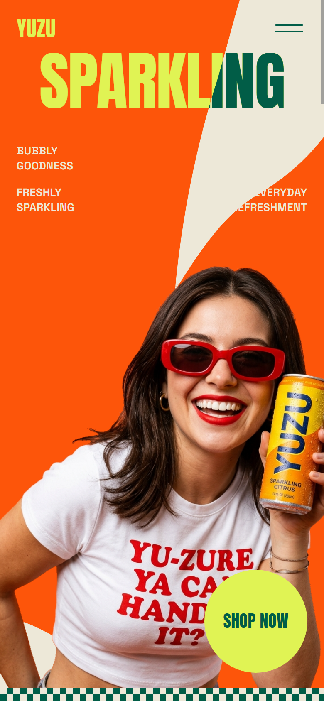
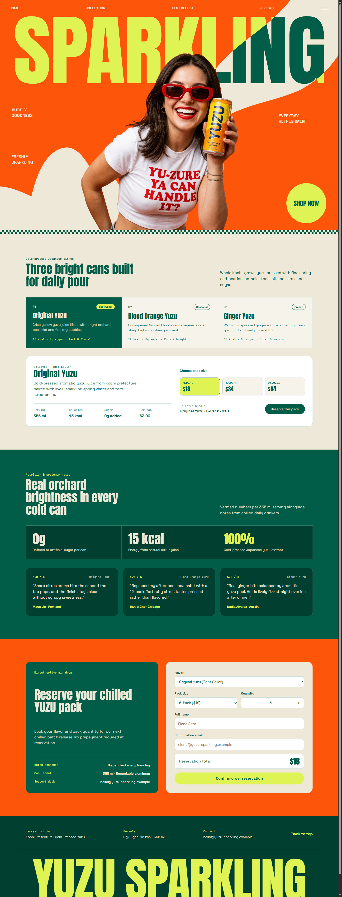

# YUZU Sparkling — Everyday Citrus Refreshment

Standalone web recreation built from the YUZU Sparkling (`SPARKLING`) citrus beverage reference design.

## Screenshots

### Desktop Hero (1440×900)


### Mobile Hero (390×844)


### Full Page


## Design System

| Role | Color | Hex |
| :--- | :--- | :--- |
| Quiet 1 (Poster Canvas) | Mandarin Orange | `#FD550A` |
| Quiet 2 (Contrast & Ink) | Forest Green | `#015D47` |
| Quiet 2 (Organic Waves) | Warm Cream | `#EDE8D8` |
| Loud Accent | Crest Yellow | `#E0F354` |

- **Typography:** Anton (color-split `SPARKLING` headline, circular `SHOP NOW` CTA, section headings), Space Grotesk (navigation, corner metadata, tasting notes, order form), JetBrains Mono (nutritional figures, indices, bundle prices).
- **Layout:** Full-viewport `100dvh` Mandarin Orange hero with sweeping Warm Cream organic waves, a `16px` Forest Green and Cream bottom checkerboard border, an SVG `<clipPath>` color-split `SPARKLING` headline transitioning from Crest Yellow to Forest Green over the wave, a bottom-centered cutout portrait, corner callouts, and a circular `SHOP NOW` CTA, followed by an interactive flavor and pack selector (`Original Yuzu`, `Blood Orange Yuzu`, `Ginger Yuzu`), a nutrition `<dl>` ledger (`0g` sugar, `15 kcal`, `100%` cold-pressed yuzu) with three customer review cards, and a synced order reservation form.

## Run Locally

Open `index.html` in a browser or serve statically:

```bash
npx serve .
```
