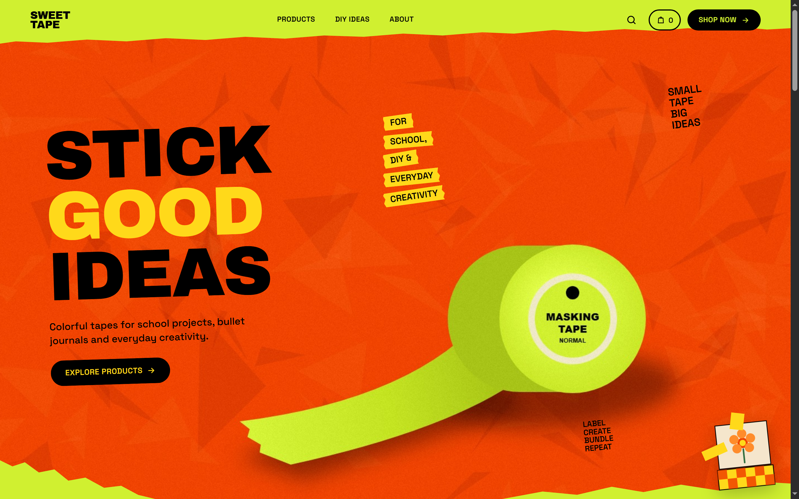
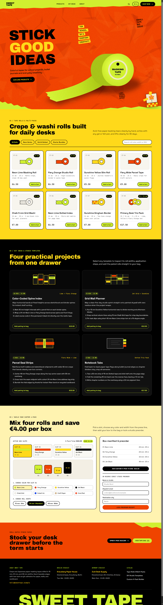
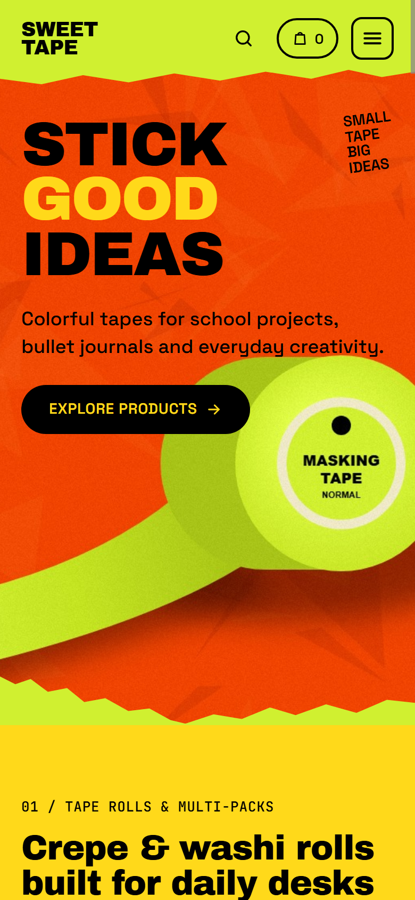

# SWEET TAPE — Stationery Brand Website

Self-contained static storefront for **SWEET TAPE** ("STICK GOOD IDEAS"), pairing a crumpled Fiery Orange hero canvas with hand-torn Neon Lime tape headers, Sunshine Yellow masking-tape stickers, and interactive roll-ordering workflows.

## Color System

- **Quiet 1 (Fiery Orange):** `#F04400` (`#D13800` deep orange)
- **Quiet 2 (Sunshine Yellow & Jet Black):** `#FFD91A` and `#000000`
- **Loud Accent (Neon Lime Green):** `#D0F030` with `#000000` ink

## Features

- **Torn-Tape Poster Hero:** Full-bleed `./assets/sweet-tape.jpg` canvas framed by `clip-path` jagged Neon Lime header and bottom-corner tape tears, stacked `STICK / GOOD / IDEAS` `Archivo Black` headline, and tilted washi-tape label stickers.
- **01 / Tape Rolls & Multi-Packs:** Category `tablist` filtering (`All Rolls`, `Neon Series`, `Grid & Dotted`, `Starter Bundles`), live search with `00` empty state, `tabular-nums` € pricing, and slide-over Tape Bag cart drawer.
- **02 / DIY Ideas & Studio Templates:** Four studio applications (`Color-Coded Spine Index`, `Grid Wall Planner`, `Parcel Seal Strips`, `Notebook Tabs`) with vector diagrams, step instructions, and one-click pairing cart additions.
- **03 / Custom 4-Pack Builder:** Interactive 4-slot color and roll-width configurator (`15 mm`, `24 mm`, `48 mm`), live roll stack preview, bag integration, and in-place preorder receipt generation.

## Screenshots

