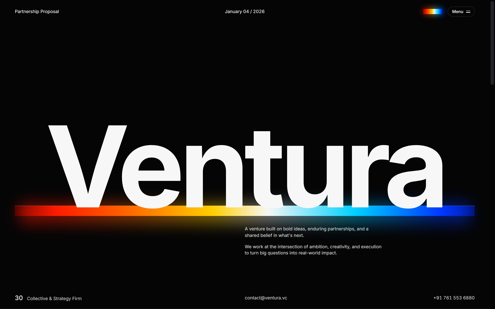
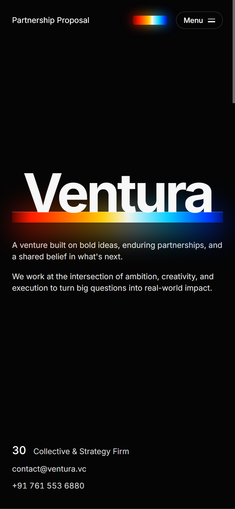
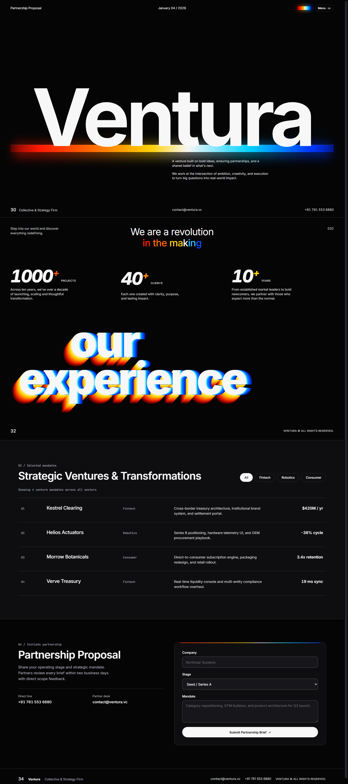

# Ventura — Collective & Strategy Firm

Pure CSS and SVG partnership showcase built on Void Black, Crisp White, and a multi-stop Chromatic Spectrum with layered retro CRT extrusion typography.

## Screenshots

### Desktop Hero (1440×900)


### Mobile Hero (390×844)


### Full Page


## Design System

| Role | Color | Hex |
| :--- | :--- | :--- |
| Quiet 1 (Void Canvas) | Void Black / Dark Slab | `#050506` / `#0E0E11` |
| Quiet 2 (Primary Ink) | Crisp White | `#F7F7F7` |
| Loud Chromatic Spectrum | Crimson / Amber / Gold / Cyan / Cobalt | `#FF1A00`, `#FF7A00`, `#FFD000`, `#00D2FF`, `#0037FF` |

- **Typography:** Inter (`400`, `500`, `600`, `700`, `800`, normal and italic) for monumental wordmarks, bold italic stats, and body prose; JetBrains Mono (`400`, `500`) for indices and metadata.
- **Visual Craft (`effects.css`):** Full-width glowing horizontal spectrum bar under the `Ventura` masthead, per-span colored headline phrases without `background-clip: text`, 14-plane layered CRT extrusion sculpture (`our / experience`) with clamped pointer parallax, segmented spectrum hover rules on the 12-column venture ledger, and an interactive partnership proposal intake form.

## Run Locally

Serve the folder statically from any HTTP server:

```bash
npx serve .
```
