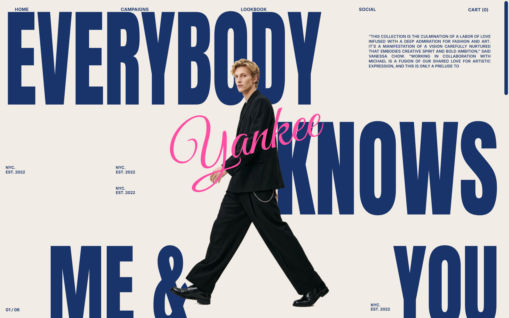
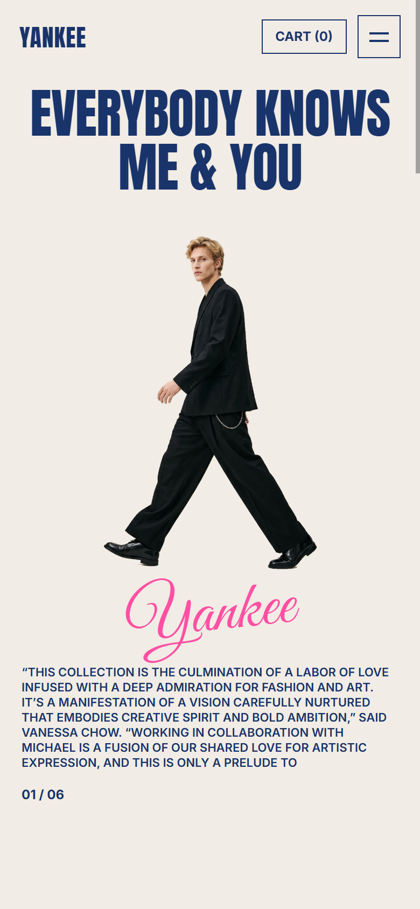
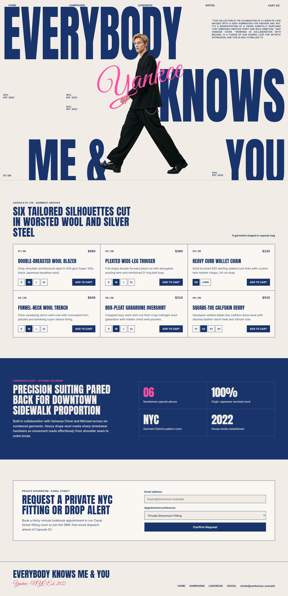

# Yankee — EVERYBODY KNOWS ME & YOU (NYC Capsule 01/06)

Standalone streetwear editorial and 6-piece capsule store for Yankee NYC Est. 2022, built in Warm Paper, Cobalt Blue, and Hot Pink.

## Screenshots

### Desktop Hero (1440×900)


### Mobile Hero (390×844)


### Full Page


## Design System

| Role | Color | Hex |
| :--- | :--- | :--- |
| Quiet 1 (Canvas) | Warm Paper | `#F1ECE5` |
| Quiet 2 (Typographic Wall & Tailoring Slab) | Cobalt Blue | `#19346B` |
| Loud Accent | Hot Pink | `#FF4FA3` |

- **Typography:** Anton (display wall and garment titles), Great Vibes (calligraphic `Yankee` hero signature), Inter (500–700 editorial manifesto, stamps, and UI).
- **Interactive Modules:** Layered four-plane hero (`z-index` 1–4) with keyed transparent portrait cutout, 6-piece capsule grid with size toggles and live `CART (N)` counter, Cobalt Blue tailoring figures, and NYC showroom RSVP form.

## Run Locally

Serve the directory over HTTP:

```bash
npx serve .
```
