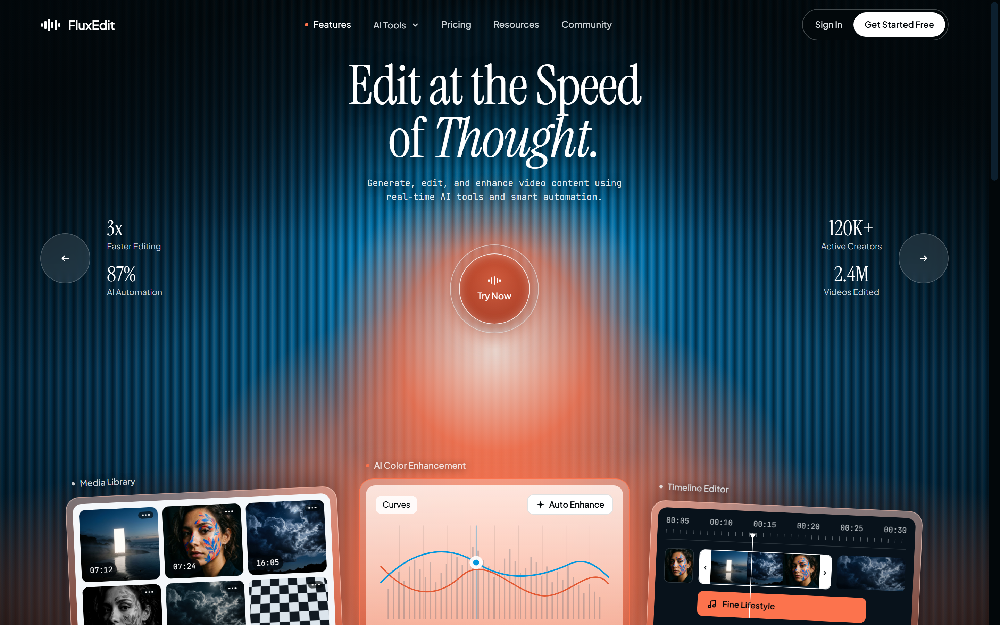
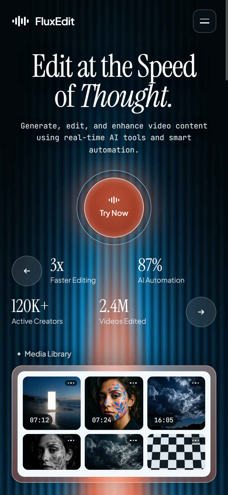
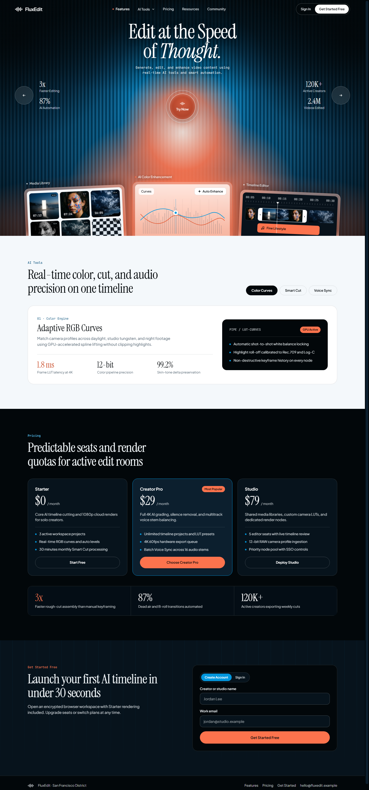

# FluxEdit — AI Video Editor

Standalone landing page for FluxEdit, a real-time AI video editing workspace built with Midnight Black, Electric Blue, and Cantaloupe Orange.

## Screenshots

### Desktop Hero (1440×900)


### Mobile Hero (390×844)


### Full Page


## Design System

| Role | Color | Hex |
| :--- | :--- | :--- |
| Quiet 1 (Canvas) | Midnight Black | `#02070A` |
| Quiet 2 (Atmosphere & Structure) | Electric Blue | `#0297DE` |
| Loud Accent | Cantaloupe Orange | `#FC734D` |

- **Typography:** Instrument Serif with Playfair Display fallback (editorial hero display and figures), Plus Jakarta Sans (UI navigation, body, and controls), JetBrains Mono (hero lead caption, timecodes, and telemetry tags).
- **Layout:** Full-viewport fluted-glass light curtain illuminated by Electric Blue and a rising Cantaloupe Orange horizon bloom behind the central Try Now orb and three tilted product preview decks (Media Library, AI Color Enhancement curves, and Timeline Editor), followed by tabbed AI Tools specs, a three-tier Pricing matrix with `<dl>` benchmarks, and an inline Get Started Free form.

## Run Locally

Serve the directory over HTTP:

```bash
npx serve .
```
