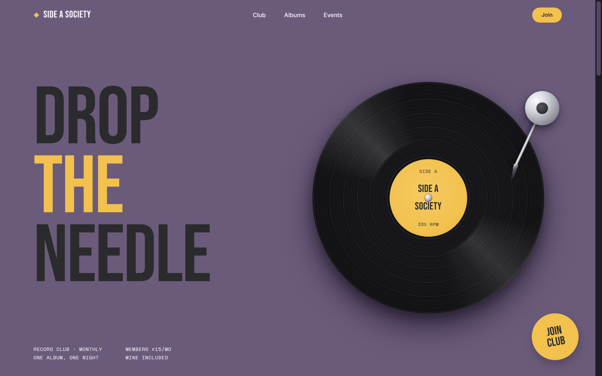
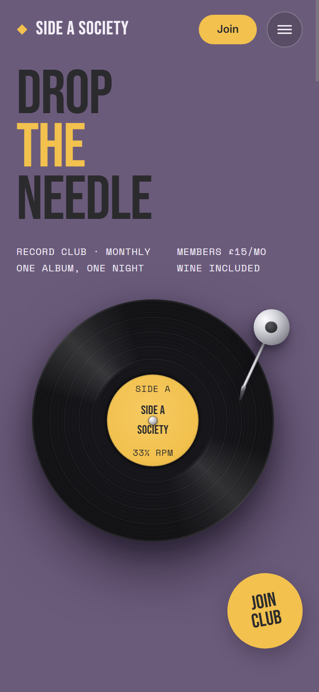
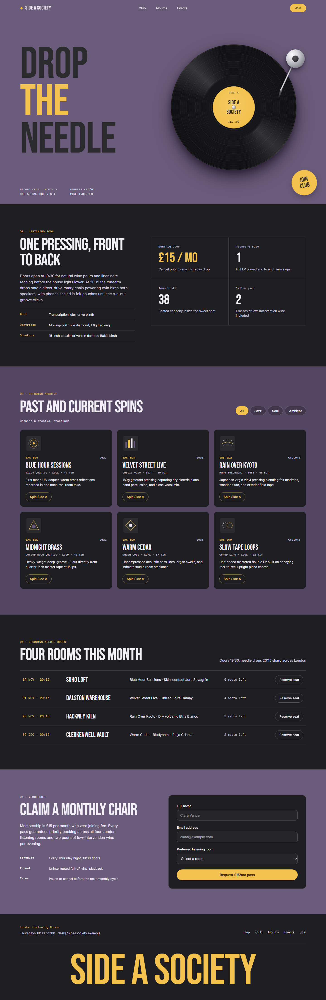

# SIDE A SOCIETY — Drop The Needle

Standalone website for SIDE A SOCIETY, a monthly London vinyl listening club built with pure CSS and inline SVG in Dusty Purple, Charcoal, and Gold.

## Screenshots

### Desktop Hero (1440×900)


### Mobile Hero (390×844)


### Full Page


## Design System

| Role | Color | Hex |
| :--- | :--- | :--- |
| Quiet 1 (Canvas & Stepped Surface) | Dusty Purple | `#6B5B7B` (`#554664` stepped) |
| Quiet 2 (Display, Ink & Dark Slab) | Charcoal | `#2B2B2E` (`#1E1E22` slab, `#111114` vinyl) |
| Loud Accent | Gold | `#F2C14E` (`#DCA832` hover) |

- **Typography:** Bebas Neue (400) for monumental display headlines, vinyl center labels, and footer wordmark; Inter (400/500/600) for navigation, controls, and editorial prose; Space Mono (400/700) for club specs, catalog indices, and tabular counts.
- **Interactive Craft:** Pure CSS and inline SVG 12-inch vinyl LP with 36 concentric grooves, dual-wedge specular vinyl sheen, brushed silver 2 o'clock tonearm assembly with live spin/nudge toggle, genre-filtered archive loading directly onto the hero platter, tabular seat-hold toggles, and validated membership registration.

## Run Locally

Serve the directory over HTTP:

```bash
npx serve .
```
