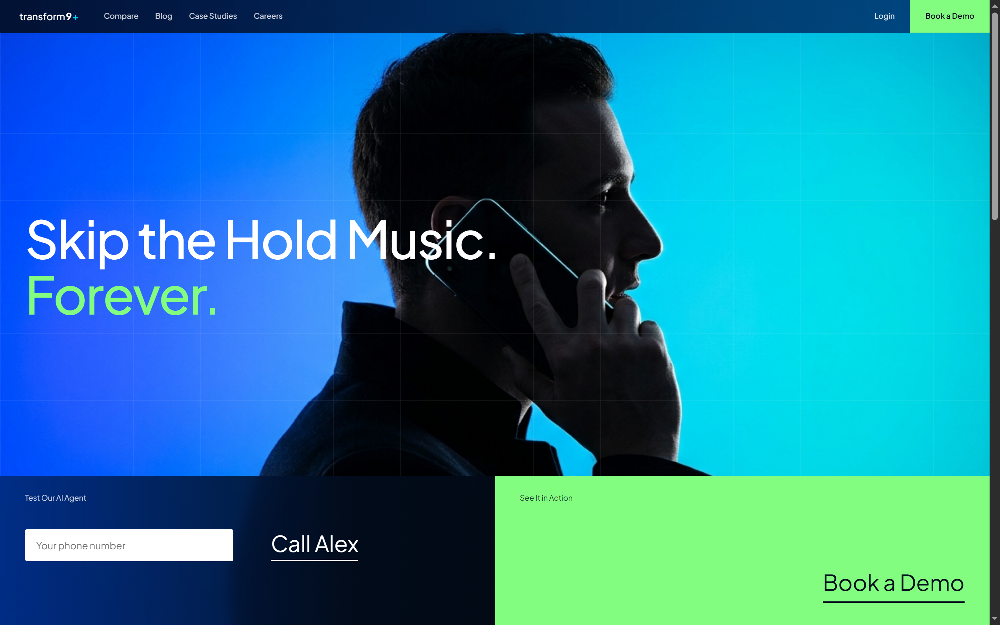
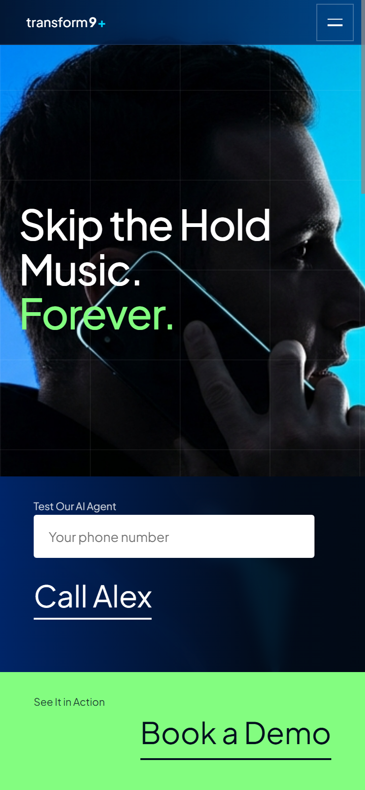
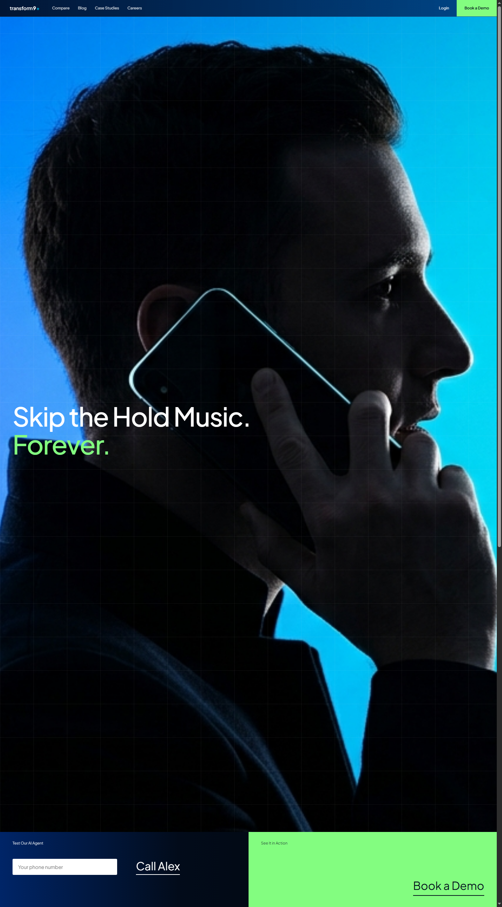

# Transform9+ — Voice AI Agents

Standalone web recreation built from the Transform9+ ("Skip the Hold Music. Forever.") reference design.

## Screenshots

### Desktop Hero (1440×900)


### Mobile Hero (390×844)


### Full Page


## Design System

| Role | Color | Hex |
| :--- | :--- | :--- |
| Quiet 1 (Sapphire Field) | Sapphire Blue | `#0042AC` |
| Quiet 2 (Atmosphere Glow) | Ocean Blue | `#00D3FB` |
| Loud Accent | Neon Jade | `#83FD80` |
| Dark Canvas | Deep Navy | `#020E24` |

- **Typography:** Plus Jakarta Sans (hero headline, inputs, and body), Space Grotesk (section headings and metrics), JetBrains Mono (latency figures and tags).
- **Layout:** Full-bleed sapphire-to-ocean backlit caller silhouette hero with subtle square grid, high-contrast `Forever.` payoff word, split bottom conversion slabs (`Test Our AI Agent` + `Call Alex` vs Neon Jade `Book a Demo`), comparison cards, and semantic `<dl>` proof metrics.

## Run Locally

Open `index.html` in any browser or serve statically:

```bash
npx serve .
```
