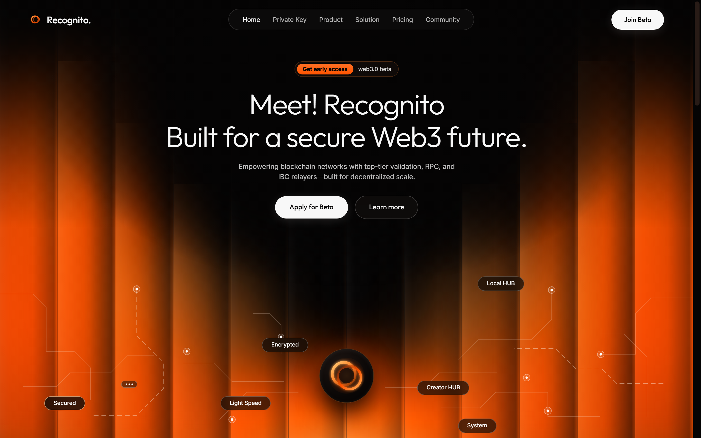
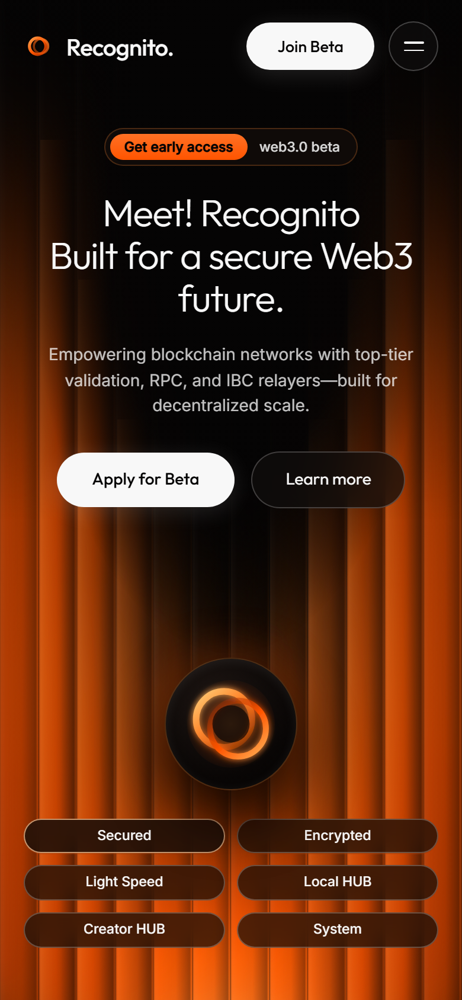
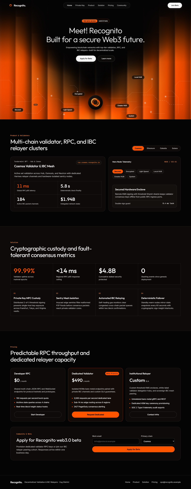

# Recognito. — Web3 Validator & Security Infrastructure

Standalone landing page for Recognito., a decentralized validator, RPC, and IBC relayer platform built with pure CSS and inline SVG in Obsidian Black, White, and Flame Orange.

## Screenshots

### Desktop Hero (1440×900)


### Mobile Hero (390×844)


### Full Page


## Design System

| Role | Color | Hex |
| :--- | :--- | :--- |
| Quiet 1 (Canvas) | Obsidian Black | `#050404` |
| Quiet 2 (Typography & Chrome) | White | `#F8F8F8` |
| Loud Accent | Flame Orange (`#FF8C32` inner glow) | `#FF5400` |

- **Typography:** Outfit (300/400/500/600) for hero display headings and buttons, Inter (400/500) for body copy and badges, JetBrains Mono (400/500) for node codes and endpoints.
- **Effects Architecture:** `effects.css` renders the 12-rib `backdrop-filter` fluted glass curtain, U-shaped Flame Orange light columns, elevated obsidian eclipse medal animation, and orthogonal SVG circuit telemetry with six interactive node chips synced to the validator inspector.

## Run Locally

Serve the directory over HTTP:

```bash
npx serve .
```
